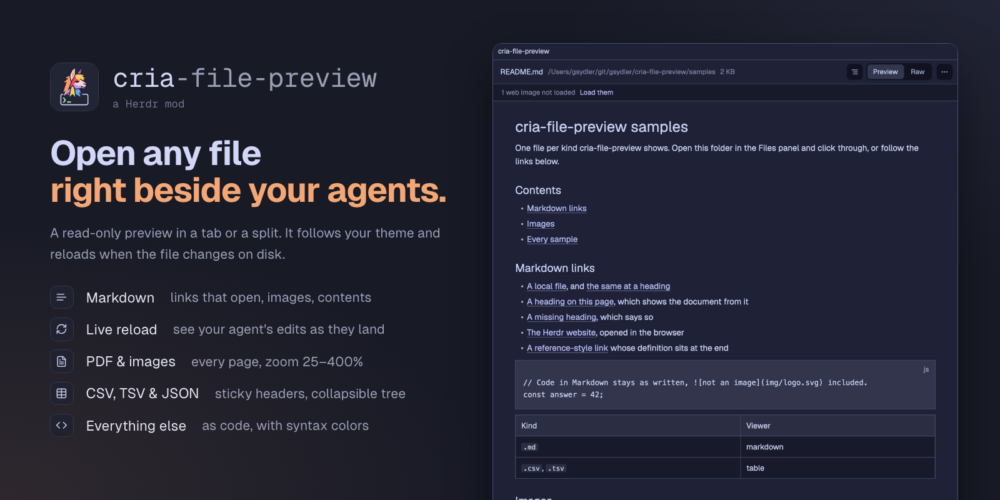

# cria-file-preview

A [Herdr](https://herdr.dev) mod that previews a file in a tab or a split: Markdown with working links and images, PDF, images, CSV and TSV tables, JSON as a tree, and any other text as code. Read-only, follows your theme, and reloads when the file changes on disk.



## Features

**The frame**

- Header: the file name (a click copies it), its folder (a click copies the full path) and its size.
- Live reload: a file on this computer reloads when it changes on disk, keeping Raw, zoom and the open JSON branches.
- Long files: code and tables show the first 4 MiB of a file over 1 MiB; Markdown and JSON say it's too large. A file that isn't UTF-8 says so.
- Back: after following a link to another file, ← returns to the previous one.
- The ⋯ menu: Open in editor (`$VISUAL` or `$EDITOR`, wait flags dropped, else the default app), Open with default app, Reveal in Finder (Explorer on Windows, the containing folder on Linux), Copy path, Copy relative path (from the repo root, else `~/`).
- Files on another machine (a remote Herdr space) open in the text-based viewers. Images, PDFs and the open and reveal actions need the file on this computer.

**The viewers**

| Kind | Extensions | What you get |
|---|---|---|
| Markdown | `.md` `.markdown` `.mdx` | Rendered, or Raw. A table of contents (with two or more headings). Web and mail links open in the browser; links to local files open in the same preview; `#heading` links show the document from that heading. Local images (SVG included) are drawn inline, and a linked image is clickable. Web images load only when you click **Load them**. |
| PDF | `.pdf` | Every page in one scrolling column, ‹ › and **Go to** page, zoom −/Fit/+. Pages render in batches of 6 from the one you jump to, up to 500 pages. Password-protected PDFs say so. |
| Image | `.png` `.jpg` `.jpeg` `.gif` `.webp` `.svg` `.bmp` `.tiff` `.heic` | Fitted to the pane or zoomed from 25% to 400%, with its size in pixels. |
| Table | `.csv` `.tsv` | A sticky header, row numbers, sideways scrolling, up to 100,000 rows drawn only while on screen. Quoted cells per RFC 4180; a `.csv` whose first line has more `;` than `,` splits on semicolons. Table or Raw. |
| JSON | `.json` | A collapsible tree: click a row to open or close it, alt-click to do the whole branch, one button to expand or collapse everything. Invalid JSON shows the parse error and the source. Tree or Raw. |
| Code | anything else | Syntax colors and line numbers, read-only, up to 400,000 characters. Binary files say so instead. |

`samples/` holds one file per kind; its `README.md` links them all, and `samples/expected.json` says what each should show.

## Install

Ask your agent in Herdr to add `herdr.dev/mods/gsydler/cria-file-preview`, or copy `mods/cria-file-preview/` into `~/.config/herdr-app/mods/`. Then check it:

```sh
herdr-app check ~/.config/herdr-app/mods/cria-file-preview
```

The mod adds nothing to your layout (`"place": "none"`). The installing agent offers to make a click on a file in your Files panel open it here instead of the panel's own text preview: Herdr's panel can't be edited, so it clones the panel, and your layout if it's one of Herdr's, and switches them over. `RECIPE.md` ("Install") has the steps, and how to undo them.

Without that, open a file with:

```sh
herdr-app do tab.new --name preview --mod cria-file-preview --props '{"file":"/absolute/path/to/file.md"}'
```

or `pane.split` with the same `mod` and `props` for a split.

## What it does on your computer

Herdr asks you to know this before adding a mod:

- **Runs programs:** on macOS and Linux, `sh` (to measure a file, read the start of a long one and stage images), `sips` or `file` (image sizes), `osascript` with PDFKit or `pdftoppm` and `pdfinfo` (PDF pages), `curl` and `file` (web images, after your click), `mv`, `rm` and `find` (in its cache folder only), your login shell (to read `$EDITOR`), and `open` or `xdg-open` for the ⋯ menu. On Windows, PowerShell does all of that, with `curl.exe` for web images and Windows' own PDF renderer, and it loads your PowerShell profile to read `$EDITOR`. Everywhere, `git` (for the relative path) and your editor.
- **Reaches the network** only when you click **Load them** on a Markdown file's web images: https only, at most 5 MB and 10 seconds each, kept only if the result is an image. Fetching them on open would tell their hosts who reads the document, and when. A web link you click opens in your browser. A Markdown link or image pointing at another computer's shared folder is refused, because Windows would connect to it and offer your credentials.
- **Reads** the file you open, and the local images a Markdown file shows, wherever they are.
- **Writes** only to `~/.config/herdr-app/data/cria-file-preview/`: copies of the images it shows and rendered PDF pages, deleted after two weeks.

## Platforms

- **macOS:** everything.
- **Linux:** everything; the tests run the image and PDF scripts on Linux in CI. PDFs need `poppler-utils` (`pdftoppm`, `pdfinfo`); without it the PDF viewer says so. TIFF and HEIC images show an error, since `file` reports no size for them.
- **Windows:** everything, with nothing to install: PowerShell and Windows' own PDF renderer do the work, and the tests run there in CI. TIFF and HEIC images depend on the codecs installed.

## Development

```sh
node --test                        # the pure modules, every sample through them, the image and PDF scripts run for real
node scripts/check-herdr.mjs       # Herdr's requirements for a shared mod (also in CI)
herdr-app check mods/cria-file-preview   # loads and renders the mod; needs the app
scripts/banner.sh                  # renders preview.png from assets/banner.html; needs Brave, Chrome or Chromium, and the internet for the fonts
```

Changes are listed in [CHANGELOG.md](CHANGELOG.md).

## License

[Apache-2.0](LICENSE). The banner's icons are from [Lucide](https://lucide.dev) (ISC; the notice is in `assets/banner.html`).
