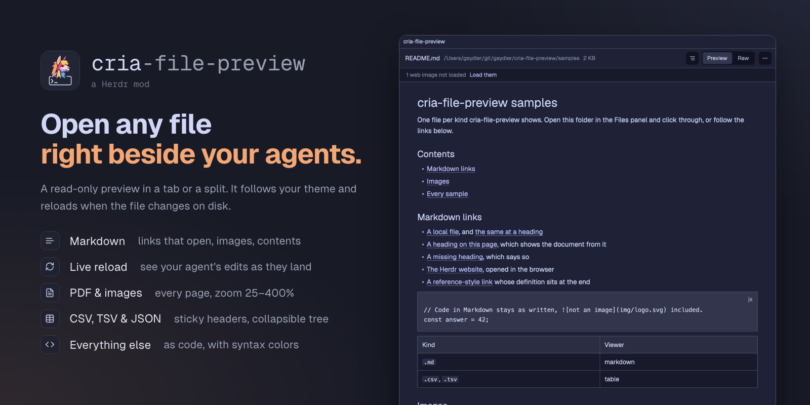

# Cria file preview

One file, shown read-only in a tab or a split, by a viewer made for its kind: Markdown rendered with working links and images, PDF pages, images, CSV and TSV tables, JSON as a tree, anything else as code. It reloads when the file changes on disk. A piece you open from your own layout or panel; it adds nothing to the layout by itself.

This file is the brief: enough to build Cria file preview from an empty folder. The files next to it are one build of it. If they don't work on your Herdr, or you want it different, build it again from here.

## What you see

All colors are theme tokens (`theme()`), so the preview follows the person's theme. Body text is 13px.

- **Header**, 42px high, 10px side padding, 8px gaps, a 1px `border` line under it:
  - **←** (only after following a link to another file), a 26px-high control with the tooltip "Back to <previous file name>".
  - The **file name**, semibold, up to 320px; then its **folder**, 12px in `dim`, truncated first; then the **size** ("2 KB"), 12px in `dim`. Name and folder turn `accent` on hover.
  - The viewer's own controls on the right (below), then **⋯**, a 28px icon button with 7px corners.
- **Body**, the rest of the pane on `background`. While loading: "Loading…" in `dim`; on failure, the error in `ansi1`, 14px from the edges.
- **Markdown:** a centered column up to 920px wide, 40px side padding, 14.5px text. Headings, lists, tables and code blocks as Herdr's Markdown view draws them; local images drawn between the text blocks at their size, shrunk to the column. Above the document, 30px bars in `surface` when they apply: "N web images not loaded · Load them" and "↑ Showing from “<heading>” · show the whole document". The **ToC** icon opens a 240px column on the left, "Table of contents", headings indented 12px per level, the current one on `selected`. An image not drawn shows as a small chip: "Image: <alt> (not found)", "(on the web)", "(loading…)", "(couldn't load)", or the reason a local one failed. Toolbar: ToC (with two or more headings), then **Preview | Raw**.
- **PDF:** pages one under another on `canvas`, as wide as the pane up to 1200px minus 48px, 16px apart, with a shadow and 3px corners; a page not rendered yet is a `surface` placeholder saying "Page N". Toolbar: **‹ 3 / 12 ›**, a 64px **Go to** field, and the zoom control **− Fit +**.
- **Image:** centered on `canvas` with 24px around it, fitted to the pane (never enlarged) or zoomed. Toolbar: "480 × 270" in `dim`, then **− Fit +** (the middle shows the percentage once zoomed).
- **Table:** the person's terminal font at 12.5px. A semibold header row on `chrome` that stays put, 26px rows striped with `surface`, a 52px column of row numbers in `dim`, columns 48 to 360px wide from their longest cell. Toolbar: "500 rows × 5 columns" ("+" after the count when capped), then **Table | Raw**.
- **JSON:** the terminal font at 12.5px, 24px rows indented 18px per level, ▾ ▸ on objects and arrays. Keys in `ansi4` (array indices in `dim`), strings `ansi2`, numbers `ansi1`, booleans and null `ansi6`, "{ 3 keys }" and "[ 2 items ]" in `dim`. The root and its first level start open. Toolbar: expand/collapse icon, then **Tree | Raw**. Invalid JSON shows "Invalid JSON: <reason>" in `ansi1` in the toolbar and the source below.
- **Code** (and Raw everywhere): Herdr's read-only editor with line numbers and syntax colors: keywords `ansi5`, strings `ansi2`, comments `dim`, functions `ansi4`, types `ansi3`, numbers `ansi1`, constants `ansi6`.
- **⋯ menu:** a 240px popup on `popover`, 30px rows with 6px corners: Open in editor, Open with default app, Reveal in Finder (or Show in Explorer, Open containing folder), a divider, Copy path, Copy relative path.

## How it behaves

There are no agent statuses or animations; the preview shows a file, not agents.

- **Which viewer:** by extension. `.md` `.markdown` `.mdx` Markdown; `.pdf` PDF; `.png` `.jpg` `.jpeg` `.gif` `.webp` `.svg` `.bmp` `.tiff` `.heic` image; `.csv` `.tsv` table; `.json` JSON; anything else code.
- **Opening:** `tab.new` or `pane.split` with `mod: "cria-file-preview"` and `props: { file, on }`, `file` absolute (on Windows with `\`, `/` or both), `on` the machine for a file in a remote space (null here).
- **Clicks in the header:** the name copies the file name, the folder copies the full path, each with a toast. **⋯** opens the menu; Open in editor runs `$VISUAL` or `$EDITOR` (read from the login shell, on Windows with the PowerShell profile) without `--wait`/`-w`, else the system opener. A failed action shows an error toast.
- **Live reload:** a file on this computer reloads when it changes on disk. The old view stays until the new one is ready, and Raw, zoom, the open JSON rows, the ToC and loaded web images stay as they were.
- **Markdown links:** `http`, `https` and `mailto` open in the system; a local file opens in this preview (← returns), at its `#heading` when it has one; a `#heading` shows the document from that heading, with the bar back to the top; an unknown heading says "No such heading here". Other schemes, and a link to another computer's share, say they can't open. A linked image is clickable. Web images load one after another only after **Load them**.
- **PDF:** ‹ › step a page, **Go to** + Enter jumps, the counter follows the scroll. Pages render 6 at a time, from the one jumped to, up to 500. A password-protected PDF says so.
- **Table:** cells are quoted per RFC 4180; a `.csv` whose first line has more `;` than `,` splits on semicolons.
- **Zoom** (PDF, image): − and + step through 25, 50, 75, 100, 125, 150, 200, 300 and 400%; a click on the middle returns to Fit.
- **JSON:** a click opens or closes a row; alt-click does the whole branch; the toolbar icon expands or collapses everything.
- **Limits:** text over 400,000 characters is cut with "… (file truncated)"; tables stop at 100,000 rows; a file with a NUL byte says "Binary file · no text preview", and one that isn't UTF-8 says "Binary or non-UTF-8 file · no text preview". Herdr reads text up to 1 MiB: past that, code and tables show the first 4 MiB, read by a program, and Markdown and JSON say the file is too large. A byte-order mark is dropped.

## Install: open files with it

Herdr's Files panel (the shipped `files` mod) shows a clicked file inline, as plain text, and has no hook for another mod. After the usual install steps, ask the person: "Should a click on a file in your Files panel open it in Cria file preview?" If yes:

1. **Find the panel.** `grep -n '"mod"' ~/.config/herdr-app/layouts/<shown layout>.json` (`herdr-app status` names the shown layout). A block with `"mod": "files"` is Herdr's panel; any other mod showing files is the person's own.
2. **Make it editable.** Herdr's layouts and mods are read-only and replaced on every start. For Herdr's panel: `herdr-app do mod.clone '{"name":"files","as":"files-preview"}'`. If the shown layout is Herdr's too (`main`, `terminals`, `win98`): `herdr-app do layout.clone '{"name":"<layout>","as":"<layout>-preview"}'`, which switches to the clone. In the layout the person now uses, change that block's `"mod": "files"` to `"files-preview"`. A panel of the person's own is edited in place.
3. **Send file clicks here.** In the panel's `main.js`, the row's click calls `this.show(path, cx)` for a file (Herdr's panel; another panel has its own handler). Replace that call, keeping folders as they are, with `run("tab.new", { name: <file name>, mod: "cria-file-preview", props: { file: <absolute path>, on: <machine or null> } })`; in Herdr's panel the absolute path is `` `${this.root}/${path}` `` and the machine is `this.on`. Import `run` from `"herdr"`.
4. **Optional, reuse a shown preview:** copy `open-file.js` into the panel's folder (a mod can't import from another mod's folder). Before opening, `shownIn(shared(OPEN), shared(MOVED), file, on, new Set(panes().map((p) => p.pane)))` gives the pane already showing the file, to focus instead; after opening, record the new pane with `setShared(OPEN, { ...shared(OPEN), [previewId(file, on)]: <pane id> })`. `openCommand({ file, on, mode })` builds the tab or split command.
5. `herdr-app check` the panel, and the layout shows no error in `herdr-app status`.

Undo: `ctrl-shift-l` back to the person's previous layout (or the block's `mod` back to `"files"`), then delete the clones.

## Built from

- **One mod**, `mods/cria-file-preview/`, `mod.json` `{ "place": "none" }`: nothing docks; whoever opens it decides where. No `keys.json`.
- **`main.js`** picks a part from `props().part`: `preview` (default, `preview.js`) or `menu` (`menu.js`, the ⋯ popup, opened with `openOverlay({ mod: "cria-file-preview", kind: "popup", width: 240, props: { part: "menu", file, on } })`).
- **Viewers** in `viewers/`, each `{ id, load(file, env, previous), start?, toolbar?, render, release? }`, registered in `viewers/index.js`; `kinds.js` maps extensions to them, anything else goes to `code`.
- **Pure modules**, unit-tested with `node --test`: `kinds.js`, `paths.js` (paths in every system's form, relative paths, what a watch reported), `links.js` (link resolution), `text-file.js` (the byte-order mark, read errors in words), `markdown-blocks.js` (Markdown cut around images and before headings, GitHub anchor slugs), `delimited.js` (RFC 4180), `json-tree.js` (JSON Pointer paths), `svg-size.js`, `size.js`, `mime.js`, `editor-command.js`, `open-file.js`, `platform.js`, `programs.js` (one table of programs per system, run for real by the tests on each).
- **`herdr` functions:** `props`, `theme`, `settings`, `notify`, `exec`, `readTextFile`, `watchFolder`, `shared`/`setShared`, `openOverlay`/`closeOverlay`, `appHome`, `home`, `window`. From `gpui-base`: `TextView.markdown`, `Editor`/`EditorState`, `v_virtual_list`, `VirtualListScrollHandle`, `Scrollbar`, `Input`/`InputState`.
- **Programs:** on macOS and Linux, `sh` (`wc -c` for the size; `head -c` for a long file; `stat`, `mkdir`, `cp` to stage an image; `curl` and `file` for a web image), bitmap sizes from `sips` on macOS or `file -b` on Linux, PDF pages as 1600px-wide PNGs from `osascript -l JavaScript` with PDFKit on macOS or poppler's `pdftoppm` (sizes from `pdfinfo`) on Linux, `mv`, `rm` and `find` (cache only), the login shell and `open`/`xdg-open` for the menu. On Windows, PowerShell scripts for all of it: WPF's `BitmapDecoder` for sizes, WinRT's `Windows.Data.Pdf` for pages, `curl.exe` for web images, the person's PowerShell profile for `$EDITOR`. Everywhere, `git rev-parse` (relative path) and the editor.
- **Shared keys** `cria-file-preview.open` and `cria-file-preview.moved` (in `open-file.js`): an opener records the pane it made per file, and the preview records where it moved after a link, so the opener reuses a pane only while it still shows that file.
- **Art:** `more.svg`, `toc.svg`, `expand.svg`, `collapse.svg`, tinted with `svg()`.

## Watch out

- **What it does on the person's computer:** it runs programs through `exec` (listed under Built from); it reaches the network only for a Markdown file's web images, after the person clicks Load them (https only, 5 MB, 10 s, kept only when the result is an image), because fetching on open would tell their hosts who reads the document; it reads the file it is asked to open and the local images a Markdown file shows, anywhere on disk, which is outside its own folder; it writes only to `data/cria-file-preview/` in the Herdr home, pruned after 14 days.
- `image()` reads only from the Herdr home, so every picture and PDF page is copied or rendered into `data/cria-file-preview/` first, named by a hash of its path and its modification time. Check that paths coming back from the PDF script stay in that folder.
- Herdr's Markdown view draws no images and no scroll area can be scrolled from code: hence the blocks cut around images and before headings, and "show from a heading" instead of scrolling to it. Fenced code is left whole, and reference definitions are repeated in every block.
- Only virtual lists scroll from code, which is why the PDF is one.
- macOS and Linux differ: `stat -c %Y` (GNU) before `stat -f %m` (BSD), because GNU's `-f` prints file-system details instead of failing; `file -b` puts a JPEG's "density 1x1" before its size. Linux needs `poppler-utils` for PDFs; TIFF and HEIC have no size from `file`.
- Windows differs most. Herdr's PATH there has no `sh`, `file`, `rm` or `mv`, and `find` is Windows' own, which exits with an error and never rejects, even where a terminal has Git's tools: test with Git off PATH. A path comes with `\`, `/` or both, and `watchFolder` reports `\\?\C:\…`, so compare normalized paths.
- PowerShell on Windows: `-Command` takes no argv, so values pass as character codes, which leave nothing to quote; scripts use no double quotes, which Windows PowerShell 5 mangles on its command line. `[IO.File]::Copy` keeps the source's date, read-only and hidden attributes, so a cached copy writes the bytes alone. Renders of one file can overlap: write to a temp name per process, and move with `[IO.File]::Move`, which fails if another got there first; `Move-Item -Force` deletes the target first. A web image's type comes from its bytes there, since a server's Content-Type can be wrong either way.
- Local Markdown images load on open, and Windows answers a path on another computer by connecting and offering the person's credentials. Refuse a link whose host differs from the document's, after turning a Windows document's backslashes: `/\host\share` is one too.
- `//` is a share on Windows and a slip elsewhere: a panel at `/` joins root and path into `//etc/x`. The document decides which a link means.
- Herdr's environment lacks `$EDITOR` when the shell sets it in `.zshenv`; ask the login shell.
- The ⋯ menu's popup closes on the click, and its copy's tasks stop within 250 ms; only an `exec` already started goes on. An action starts its one program straight away: for Open in editor, one `sh` process asks the login shell and opens the file, and on Windows one PowerShell process loads the profile and does the same.
- The alt modifier arrives with the mouse press, not the virtual list's click: record it on mouse down.

## Done when

- `herdr-app check mods/cria-file-preview` passes, and `node --test` passes, on Windows with Git off PATH.
- Each file in `samples/` opens in the viewer `samples/expected.json` names and shows what it lists.
- In the samples' `README.md`: a link to `docs/setup.md#install` opens that file from its Install heading and ← returns; `#every-sample` shows the document from that heading; `#nowhere` says there is no such heading; the SVG and PNG draw inline; the web image waits for Load them.
- `sample.pdf` shows 2 pages; Go to 2 jumps there; + and − zoom and the middle returns to Fit.
- `table.csv` shows 500 rows × 5 columns with the header fixed while scrolling; `data.json` opens and closes rows, alt-click does a branch; `broken.json` shows its parse error and source.
- Editing an open file reloads it while keeping Raw or the zoom.
- The ⋯ menu's actions work, and a click on the name or folder copies it.
- With the Files panel patched (Install), a click on a file opens it here and a click on a folder still opens the folder.
