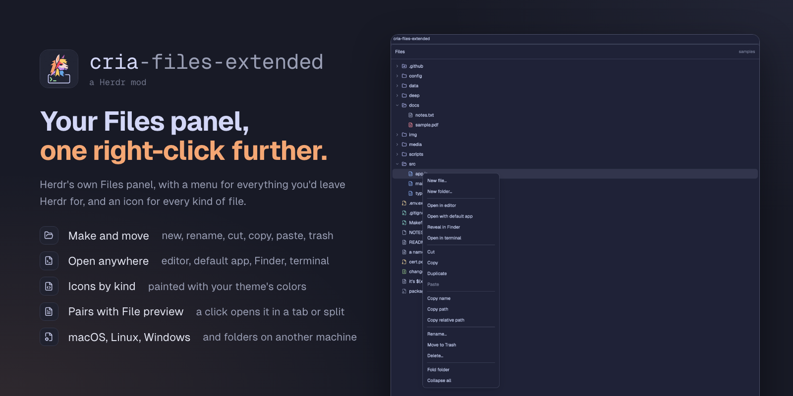

# cria-files-extended

A [Herdr](https://herdr.dev) mod: Herdr's Files panel with a right-click menu and an icon for each kind of file. Make, rename, copy, move, trash and delete files and folders without leaving Herdr, open them in your editor, your default app, Finder or a terminal, and copy their name or path. A click on a file opens it in [cria-file-preview](../file-preview/) when you have it, and in the panel's own text preview when you don't.



## Features

**The tree**

- Herdr's Files panel as it is: the focused pane's folder, folders that open and close, git's marks (A, M, D, U), refreshed on every change on disk.
- An icon for each kind of file (code, scripts, data, config, text, PDF, tables, images, video, audio, archives, databases, fonts, diffs, keys, lock files), painted with your theme's colors. `"icon_colors": false` makes them all one color.
- With [cria-file-preview](../file-preview/) installed, a click opens the file there: in a new tab, or a split to the right or below (`"open"`). A file already open is brought forward instead of opened again, and the tree stays on its folder. Without it, Herdr's own preview shows the file in the panel.

**The right-click menu**

| Group | Rows |
|---|---|
| New | New file…, New folder… (in the folder, or beside the file) |
| Open | Open in editor (`$VISUAL` or `$EDITOR`, wait flags dropped, else the default app; vim, nano and other terminal editors open in a new Herdr tab), Open with default app, Reveal in Finder (Show in Explorer on Windows, Open containing folder on Linux), Open in terminal |
| Clipboard | Cut, Copy, Duplicate, Paste. A name already there gets Finder's "a copy.txt"; nothing already there is ever replaced. |
| Copy | Copy name, Copy path, Copy relative path (from the git checkout, else the panel's folder) |
| Change | Rename…, Move to Trash (Recycle Bin on Windows, except on a network share), Delete… (asks first, deletes for good; a link is deleted, not what it points to) |
| Fold | Expand all (a folder and every folder in it, up to 100 folders), Fold folder, Collapse all |

↑ ↓ Enter and Esc work in the menu. New, Rename and Delete ask in place of the menu. A row your system can't do is left out: a file on another machine has no Open, Reveal or Trash.

`samples/` is a small tree with one file per icon; `samples/expected.json` says what each row shows and what each menu row does.

## Install

Ask your agent in Herdr to add `herdr.dev/mods/gsydler/herdr-cria--files-extended`, or copy `mods/cria-files-extended/` (in this folder) into `~/.config/herdr-app/mods/`. Then check it:

```sh
herdr-app check ~/.config/herdr-app/mods/cria-files-extended
```

The mod adds nothing to your layout (`"place": "none"`). The installing agent offers to swap it in for your Files panel: in the panel's block, `"mod": "cria-files-extended"`, and if your layout is one of Herdr's, it clones the layout first. `RECIPE.md` ("Install") has the steps, and how to undo them. The block's `props`:

```json
{ "mod": "cria-files-extended", "props": { "open": "split-right", "icon_colors": true } }
```

**With cria-file-preview.** Install them in either order; each works alone. This panel looks for cria-file-preview at each click, so adding it later needs nothing more. If you added cria-file-preview first and let it patch your Files panel, this panel replaces that patched copy, and the installing agent offers to delete it.

## What it does on your computer

Herdr asks you to know this before adding a mod:

- **Runs programs:** on macOS and Linux, `sh` to list folders and for New, Rename, Paste, Duplicate and Delete (`mkdir`, `mv`, `cp`, `rm`); `git` for the marks; `open`, or `xdg-open` and `gio` on Linux, for Open, Reveal and the Trash, and macOS 15's `trash`; your login shell (to read `$EDITOR`) and your editor. On Windows, PowerShell does all of it, and loads your PowerShell profile to read `$EDITOR`. A file's path reaches each program as an argument, never as part of a script.
- **Changes files** only when you pick New, Rename, Paste, Duplicate, Move to Trash or Delete. Delete asks first and deletes for good; Move to Trash can be undone from the Trash. On Windows, a network share mapped to a drive letter may have no Recycle Bin, and Windows then deletes for good.
- **Reads** the folders it shows, and the file Herdr's preview shows, wherever they are.
- **Never reaches the network**, and writes nothing of its own.

## Platforms

- **macOS:** everything. Move to Trash needs macOS 15 or later.
- **Linux:** everything with `xdg-open` (Open, Reveal) and `gio` (Trash); without them those rows are left out.
- **Windows:** everything, with nothing to install: PowerShell does the work. The tests run the listing and the menu's commands there in CI; Open, Reveal and the Recycle Bin are tested for their form only.
- **Another machine** (a remote Herdr space): the tree and the menu's file actions, through `sh`. A remote Windows machine lists its folders but its menu actions fail.

## Development

This folder is one entry of the [herdr-cria](../README.md) repo, which holds the tooling shared by all its mods. Run these from the repo's top folder:

```sh
node --test 'files-extended/tests/*.test.mjs'   # the pure modules, the samples, the listing and the menu's commands run for real
node scripts/check-herdr.mjs files-extended      # Herdr's requirements for a shared mod (CI checks every entry)
herdr-app check files-extended/mods/cria-files-extended   # loads and renders the mod; needs the app
scripts/banner.sh files-extended                 # renders preview.png from assets/banner.html; needs Brave, Chrome or Chromium, and the internet for the fonts
```

Changes are listed in [CHANGELOG.md](CHANGELOG.md); releases are tagged `files-extended/vX.Y.Z`.

## License

[Apache-2.0](../LICENSE). Based on Herdr's own Files panel, also Apache-2.0: [NOTICE](NOTICE) says what came from it and what changed. The icons are [Lucide](https://lucide.dev)'s (ISC, `mods/cria-files-extended/icons/LICENSE`).
