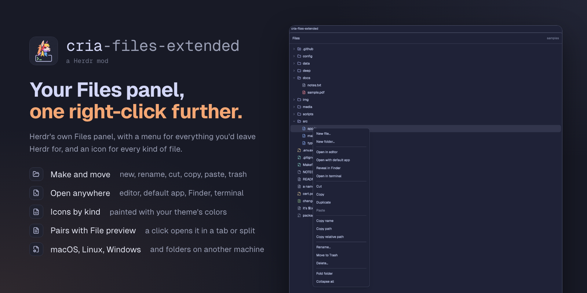

# Cria files extended

Herdr's Files panel with a right-click menu and an icon per kind of file. The menu makes and renames files and folders, cuts, copies, duplicates and pastes them, sends them to the Trash, opens them in your editor, your default app, Finder or a terminal, and copies their name or path. A click on a file opens it in [Cria file preview](https://herdr.dev/mods/gsydler/herdr-cria--file-preview) when that mod is installed, and in the panel's own text preview when it isn't. A panel for your own layout; it adds nothing to the layout by itself.

This file is the brief: enough to build Cria files extended from an empty folder. The files next to it are one build of it. If they don't work on your Herdr, or you want it different, build it again from here.

## What you see

All colors are theme tokens (`theme()`), so the panel follows the person's theme. Text is 13px.

- **The panel:** 10px corners, a 1px `border`, on `background`.
- **Header**, 42px high, 14px side padding, a 1px `border` line under it: **Files** in semibold, then on the right, 12px in `dim` and truncated, the folder's name (or the previewed file's path, with **←** before "Files" in `muted` to go back to the tree).
- **The tree**, 6px from the edges, scrolling with a scrollbar: rows 28px high with 7px corners, indented 8px plus 18px per level, 7px gaps, `hover` under the pointer and under the row a menu is open for. Each row: a 12px chevron in `dim` (right when closed, down when open; folders only), a 14px icon, the name truncated, and git's mark at the end in 11px: **A** (added or untracked) in `ansi2`, **D** (deleted) and **U** (conflict) in `ansi1`, **M** (any other change) in `blocked`.
- **Icons** are [Lucide](https://lucide.dev)'s, single-color, painted with a theme key: folders `accent` (`folder`, `folder-open` when open, `folder-git` for `.github` and `.gitlab`); code `ansi4`; shell scripts `ansi2`; data (JSON, YAML, TOML, XML) `ansi3`; config (INI, `Makefile`, `Dockerfile`, `.gitignore`, `.*rc`) `ansi6`; text and Markdown `muted`; PDF `ansi1`; tables `ansi2`; images, video and audio `ansi5`; archives `ansi1`; databases `ansi6`; fonts `muted`; diffs `ansi2`; keys and `.env` files `ansi3`; lock files `dim`; anything else a plain file in `muted`. Block prop `"icon_colors": false` paints them all `muted`.
- **Messages** in the tree, 12px in `dim`: "Loading files…", "No files", "No folder", or a listing's error. Past the limits, 11px: "File list limited to 500 entries per folder and 5,000 total", and "Expand all stopped at 100 folders".
- **The menu**, where the right click was: 220px on `popover`, 10px corners, a `border` and a large shadow, 5px inside, 12.8px text. Rows 31px with 7px corners, 8px side padding, `hover` under the pointer, `selected` on the row the keys moved to, `dim` when it can't run. 1px `border` dividers between the groups:
  - New file…, New folder…
  - Open in editor, Open with default app (files only), Reveal in Finder (Show in Explorer on Windows, Open containing folder on Linux), Open in terminal
  - Cut, Copy, Duplicate, Paste
  - Copy name, Copy path, Copy relative path
  - Rename…, Move to Trash (Move to Recycle Bin on Windows), Delete…
  - Expand all (folders), Fold folder (an open folder, or a file's own folder), Collapse all
- **Asking in place of the menu**, 260px on the same surface: New file…, New folder… and Rename… show a semibold title ("New file", "New folder", "Rename <name>"), "in <folder>/" in 11.5px `dim` for a new item, a name field, an error in 11.5px `ansi1` when the name can't be used, then **Cancel** (on `raised`) and **Create** or **Rename** (on `solid`), 28px buttons with 7px corners. Delete… shows "Delete <name>?" in semibold, "The file is deleted for good, not moved to the Trash." (or "The folder and everything in it…") in `muted`, then **Cancel** and **Delete** on `ansi1`.
- **Herdr's own preview**, when Cria file preview isn't installed: the file in Herdr's read-only editor, the person's terminal font at 12px, with syntax colors (keywords `ansi5`, strings `ansi2`, comments `dim`, functions `ansi4`, types `ansi3`, numbers `ansi1`, constants `ansi6`), in place of the tree.

## How it behaves

There are no agent statuses or animations; the panel shows files, not agents.

- **Which folder:** the focused pane's folder, else the focused terminal's, else the space's. While a mod's pane has the focus (a Cria file preview, say, which has no folder), the tree stays on the folder it showed, as long as the space is the same. Each folder keeps which subfolders were open, and the file Herdr's preview showed, when the panel moves to another folder and back.
- **Fresh:** every 10 seconds, and on any change on disk for a folder on this computer; a folder on another machine waits for the 10 seconds. A change during a refresh brings one more refresh after it. git's marks come with each refresh. An open folder that can no longer be read closes.
- **A click** on a folder opens or closes it. On a file, with Cria file preview installed (looked for at each click): a file already shown in a preview focuses that pane; otherwise a new preview opens, by block prop `open`: `"tab"` (default), `"split-right"` or `"split-down"`. Without it, Herdr's own preview fills the panel, and **←** returns to the tree.
- **A right click** on a row opens the menu there; beside the rows, nothing. ↑ and ↓ move through the rows that can run (wrapping), Enter runs one, Esc or a click outside closes it. An action runs on the row's file or folder:
  - **New file…, New folder…** ask for a name and make it in the folder, or beside the file; the folder opens to show it. **Rename…** asks with the name filled in. A name that is empty, `.`, `..` or holds a `/` (or a `\` on Windows) says why; one already there says "<name> already exists here". A rename that only changes case works, also on a disk that ignores case; on a disk that keeps case apart, it never replaces another item with the new name. Enter in the field confirms, Esc cancels.
  - **Open in editor** runs `$VISUAL` or `$EDITOR` (read from the login shell; on Windows, with the PowerShell profile) without `--wait` or `-w`, else the default app. On macOS and Linux an editor that draws in a terminal (vim, nvim, nano, micro, Helix, Kakoune, `emacs -nw`…) opens in a new Herdr tab in the file's folder. **Open with default app** and **Reveal** use the system's own. **Open in terminal** opens a new tab in the folder (a file's own folder).
  - **Cut** and **Copy** keep the item in the panel's own clipboard, not the system's; **Paste** (enabled once something is cut or copied on this machine) puts it in the folder, or beside the file. A name already there becomes Finder's "a copy.txt", "a copy 2.txt", whatever its case on macOS and Windows; an item that turns up there meanwhile is never replaced (Paste fails and says so). After Cut, the item moves, and Paste is off again once it has; pasting it back into its own folder does nothing. A folder can't go inside itself. **Duplicate** pastes a copy beside the item at once.
  - **Copy name, path, relative path** write to the system clipboard with a toast showing what was copied. The relative path starts at the git checkout, else at the panel's folder; the path uses `\` on Windows.
  - **Move to Trash** sends the item to the Trash (the Recycle Bin on Windows), with a toast; on Windows it is left out for an item on a network share (a path starting `\\`), which has no Recycle Bin. **Delete…** asks first: Enter deletes for good (an Enter still held from the menu doesn't), Esc cancels. Deleting a link deletes the link, not what it points to.
  - **Expand all** opens a folder and every folder in it, up to 100 folders and the panel's 5,000 entries; a fold or Collapse all meanwhile stops it. **Fold folder** closes one; **Collapse all** closes them all.
- **A failed action** shows an error toast: "Couldn't <what it did>" and the program's message.
- **Limits:** 500 entries a folder, 5,000 in the tree, 40 levels deep, 5,000 git marks, 100 folders opened by Expand all (each open folder is listed again at every refresh). An action's program gets 10 minutes, then fails. Herdr's preview stops at 400,000 characters with "… (file truncated)"; a file with a NUL byte says "Binary file · no text preview".

## Install: put it in your layout

The mod is `"place": "none"`: copying it in shows nothing. After the usual install steps, ask the person: "Should Cria files extended replace your Files panel?" If yes:

1. **Find the panel.** `grep -n '"mod"' ~/.config/herdr-app/layouts/<shown layout>.json` (`herdr-app status` names the shown layout). A block with `"mod": "files"` is Herdr's panel. A block whose mod is a clone of it, such as `files-preview` made when Cria file preview was installed, is a Files panel too: it was patched to open the preview, and this mod does that by itself.
2. **Make the layout editable.** If the shown layout is Herdr's (`main`, `terminals`, `win98`): `herdr-app do layout.clone '{"name":"<layout>","as":"<layout>-files"}'`, which switches to the clone. Herdr's layouts are replaced on every start.
3. **Swap the mod.** In that block, set `"mod": "cria-files-extended"`, keeping its `id`. Optional `props`: `"open"` (`"tab"`, `"split-right"` or `"split-down"`) and `"icon_colors": false`.
4. **Tidy up.** If the block had a clone made at Cria file preview's install, and no other layout names it (`grep -l '"<clone>"' ~/.config/herdr-app/layouts/*.json`), offer to delete `mods/<clone>/`.
5. `herdr-app check ~/.config/herdr-app/mods/cria-files-extended`, and the layout shows no error in `herdr-app status`.

Cria file preview, installed before or after, needs nothing more: this panel looks for it at each click. Its own install asks to patch the Files panel; that step leaves this mod as it is.

Undo: `ctrl-shift-l` back to the person's previous layout (or the block's `mod` back to what it was), then delete the clone.

## Built from

- **One mod**, `mods/cria-files-extended/`, `mod.json` `{ "place": "none" }`: the person's layout docks it. No `keys.json`.
- **Block props:** `open` (`"tab"`, `"split-right"` or `"split-down"`: where a click opens Cria file preview) and `icon_colors` (`false` paints every row icon `muted`).
- **`main.js`**: Herdr's shipped `files` mod at 0.1.15 (Apache-2.0, see `NOTICE`), with the menu, the icons and the opener added. A right press on a row records the row; the panel's own right-press handler, which runs after it, opens the menu at the press. The menu is a `Popup` anchored there.
- **Pure modules**, unit-tested with `node --test`: `listing.js` (a folder's listing per system and its output, git's marks), `platform.js` (the menu's commands per system, as `[program, args]`), `menu.js` (which rows the menu lists), `names.js` (names refused, Finder's copy names, what Paste refuses), `paths.js` (paths with either separator, compared without case on macOS and Windows, relative paths), `previews.js` (which new preview pane a click made), `icons.js` (icon and color by name or extension), `editor-command.js` (the editor's command, and whether it draws in a terminal), `open-file.js` (how a file opens in Cria file preview). `editor.js`, `editor-command.js` and `open-file.js` are identical to Cria file preview's copies.
- **`herdr` functions:** `spaces`, `panes`, `focused`, `exec` (with a 10-minute timeout for the menu's actions), `readTextFile`, `watchFolder` (a change on disk refreshes the tree), `theme`, `settings`, `window`, `props`, `run`, `notify`, `shared`/`setShared`, `appHome`; `fs.exists` from `fs/promises` to look for Cria file preview. Commands: `tab.new`, `pane.split`, `pane.focus`, `terminal.open` (Open in terminal, and a terminal editor as its `argv`). From `gpui-base`: `Editor`/`EditorState`, `Popup`, `Input`/`InputState`.
- **Programs:** on macOS and Linux, and on another machine, `sh` lists a folder and does New, Rename, Paste, Duplicate and Delete (`mkdir`, `mv`, `cp -R`, `rm -rf`; Paste and Duplicate refuse a name already taken); `git rev-parse` and `git status` give the marks. On this computer: `open`/`open -R` and macOS 15's `trash` on macOS, `xdg-open` and `gio trash` on Linux, the login shell for `$EDITOR`, and the editor. On Windows, PowerShell does all of it: `Get-ChildItem`, `Move-Item`, `Copy-Item`, `Remove-Item`, the Recycle Bin through `Microsoft.VisualBasic`, `Invoke-Item`, `explorer.exe`, and the PowerShell profile for `$EDITOR`.
- **Shared keys** `cria-file-preview.open` and `cria-file-preview.moved` (in `open-file.js`): the pane opened per file, and where a preview moved after following a link, so a click reuses a pane only while it still shows that file. `run()` returns no ids, so the new pane is found by comparing `panes()` before and after.
- **Art:** `chevron-down.svg` and `chevron-right.svg` from Herdr's panel, and Lucide's icons in `icons/` (ISC, `icons/LICENSE`), tinted with `svg()`.

## Watch out

- **What it does on the person's computer:** it runs programs through `exec` (listed under Built from), every value passed as an argument (to PowerShell, as character codes), never as script text. It changes files only when the person picks New, Rename, Paste, Duplicate, Move to Trash or Delete, and Delete asks first, since it deletes for good. It reads any folder the panel shows, and any file Herdr's preview shows, which is outside its own folder. It never reaches the network and writes nothing of its own.
- Herdr's shipped mods are read-only and replaced on every start: this is a clone, and `"place": "none"` keeps it out of the layout until the person swaps it in (Install).
- A mod pane has no folder (`panes()` gives `cwd: null`) and `space.folder` is only where the space's first shell started, so a panel following the focus would jump away from the tree on a click. The panel keeps its last folder while any mod's pane has the focus.
- Cria file preview is optional: look for `mods/cria-file-preview/main.js` at each click, not once, since the panel can load before that mod is copied in.
- PowerShell's `-Command` takes no argv, so values pass as character codes, which leave nothing to quote; scripts use no double quotes, which Windows PowerShell 5 mangles on its command line. Herdr's PATH on Windows has no `sh`, `mv` or `rm`, even where a terminal has Git's tools: test with Git off PATH.
- `Move-Item` refuses a folder rename that only changes case: go through a temporary name, unique to the rename. On a disk that ignores case, the new name already "exists": let a case-only rename through when both names are the same item (`[ "$1" -ef "$2" ]`), and refuse it otherwise, since Linux keeps `a.txt` and `A.txt` apart.
- `mv`, `cp -R`, `Move-Item` and `Copy-Item` replace a file already at the destination, and put a folder inside a folder already there: each command checks the destination first. Finder's copy name is chosen from a listing capped at 501 entries that skips `.git`, so the command's own check is the one that holds.
- Windows PowerShell 5.1's `Remove-Item -Recurse` follows a junction or a link to a folder and deletes what it points to: Delete removes links on their own, and the links inside a folder before the folder.
- Windows deletes for good, without asking, what it is told to send to the Recycle Bin on a drive that has none: a network share (`\\server\share`, `\\wsl$`) is recognised by its path and has no Move to Recycle Bin row, but a network share mapped to a drive letter looks like a local disk and still shows it.
- `exec` waits 30 seconds by default and then fails: the menu's actions get its longest, 10 minutes, so a big copy or delete isn't reported as failed while it runs on.
- A terminal editor run by `exec` has no terminal and shows nothing: the `sh` script prints its words back after a marker, and the panel opens them with `terminal.open`. The login shell's own output is read after a marker too, so a profile's greeting can't end up in `$EDITOR`; a fish login shell gets a POSIX `sh` snippet to run. zsh's login shell reads `.zshenv`, `.zprofile` and `.zlogin`, not `.zshrc`: an `$EDITOR` set only there isn't seen. Windows starts the editor in its own console window, terminal or not.
- Windows lists links as folders even when they're dangling: check their target. OneDrive's folders are reparse points without a `LinkType`, and are folders.
- Another machine with no `sh` is a Windows one: its tree lists through PowerShell, as Herdr's panel does, but the menu's actions there are `sh` commands and fail.
- Open, Reveal and the Trash need a desktop: a file on another machine has none of them. macOS before 15 has no `trash`, and Linux without `xdg-open` or `gio` lacks those rows; leave a row out rather than fail.
- `git status` runs with `--no-optional-locks` and `core.fsmonitor=false`: anything it writes under `.git` would wake the folder watch, which would refresh again.
- The menu's keys are handled on the panel's root, which tracks the menu's focus handle: with the handler on the menu inside the `Popup`, ↑, ↓ and Enter did nothing. The right click that opens the menu can move the keyboard back after the panel's handler, so the panel focuses the handle again 100 ms later. The name field takes the keys while asking. Key events repeat while a key is held (`is_held`): Delete's confirmation ignores a held Enter, which could come from choosing Delete… with Enter.

## Done when

- `herdr-app check mods/cria-files-extended` passes, and `node --test` passes, on Windows with Git off PATH.
- Pointed at `samples/`, every row shows the icon and color `samples/expected.json` lists, folders first, names whole.
- Each `manual` step in `samples/expected.json` does what it says: folding, Expand all, Collapse all, the menu's rows per system, the copies, Duplicate, Rename, New, Cut and Paste, Delete, Move to Trash.
- With Cria file preview installed, a click on a file opens a preview and a second click focuses it; the tree stays on its folder. Without it, Herdr's preview opens in the panel and ← returns.
