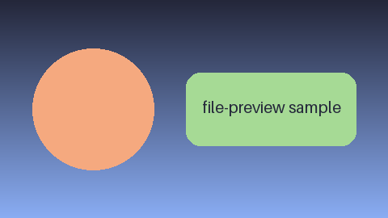

# cria-file-preview samples

One file per kind cria-file-preview shows. Open this folder in the Files panel and click through, or follow the links below.

## Contents

- [Markdown links](#markdown-links)
- [Images](#images)
- [Every sample](#every-sample)

## Markdown links

- [A local file](docs/setup.md), and [the same at a heading](docs/setup.md#install)
- [A heading on this page](#every-sample), which shows the document from it
- [A missing heading](#nowhere), which says so
- [The Herdr website](https://herdr.dev), opened in the browser
- [A reference-style link][herdr] whose definition sits at the end

```js
// Code in Markdown stays as written,  included.
const answer = 42;
```

| Kind | Viewer |
|---|---|
| `.md` | markdown |
| `.csv`, `.tsv` | table |

## Images

An SVG, drawn between two Markdown blocks:


A PNG that links to the PDF (click it): [](sample.pdf)

A missing image: 

A web image, shown as a link: 

## Every sample

| File | Viewer | Try |
|---|---|---|
| [README.md](README.md) | markdown | ToC icon, Preview / Raw, links, images |
| [docs/setup.md](docs/setup.md) | markdown | Back, `#install` |
| [sample.pdf](sample.pdf) | pdf | 2 pages, zoom −/Fit/+ |
| [img/logo.svg](img/logo.svg) | image | Fit, zoom |
| [img/picture.png](img/picture.png) | image | |
| [img/picture.jpg](img/picture.jpg) | image | |
| [img/picture.gif](img/picture.gif) | image | |
| [table.csv](table.csv) | table | quoted commas, 500 rows, Table / Raw |
| [table.tsv](table.tsv) | table | tabs |
| [data.json](data.json) | json | open and close rows, Expand all, Collapse |
| [broken.json](broken.json) | json | the parse error, Raw |
| [code.js](code.js) | code | syntax colours |
| [notes.txt](notes.txt) | code | plain text |

Edit any of them while its preview is open: it reloads by itself.

[herdr]: https://herdr.dev
